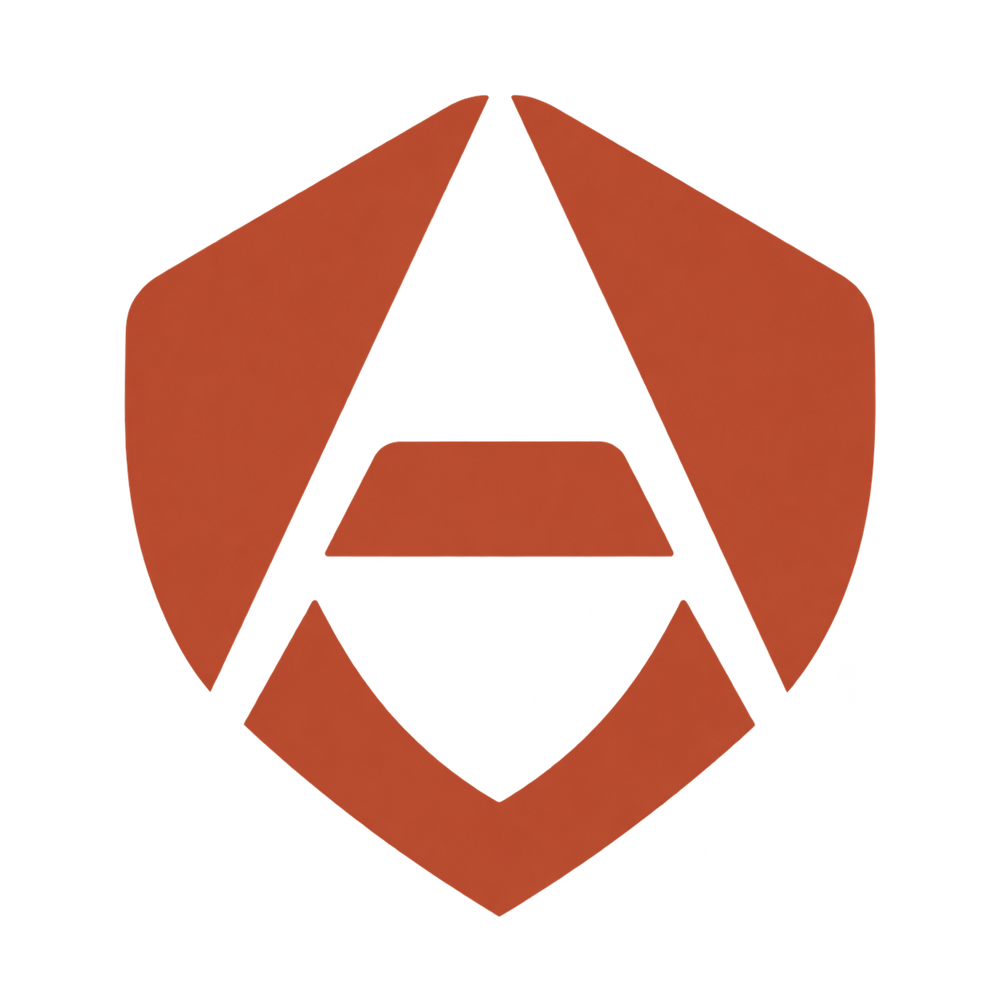
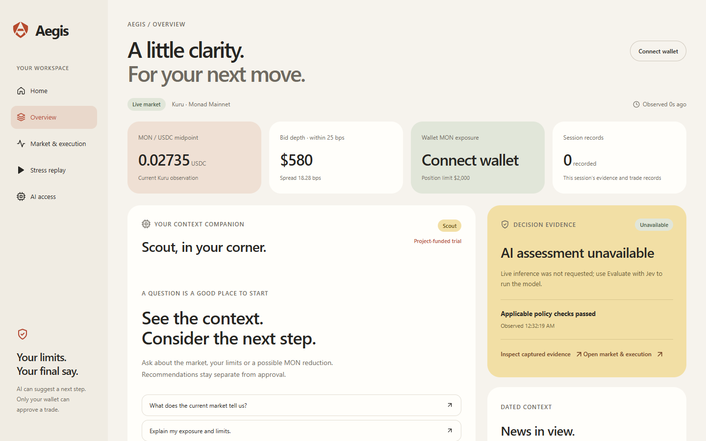

# Aegis

**Understand your exposure. Make your next move with context.**

Fast markets scatter the information you need across charts, headlines and your wallet. Aegis brings that context together, explains where you stand and helps you review a decision against your own trading limits.

Built on Monad, Aegis combines live market data with Scout, an AI copilot you can ask about the market, your holdings and your limits. When you decide to reduce MON exposure, it prepares a MON → USDC sale with exact terms for you to review. You keep the final say: policy changes require confirmation, and transactions require your wallet signature.

[Open Aegis](https://aegis.himaloy2608.workers.dev/) · [Dashboard](https://aegis.himaloy2608.workers.dev/app) · [Market & execution](https://aegis.himaloy2608.workers.dev/app/workspace)



## What you can do

- **Read the market:** inspect the Kuru MON/USDC book, liquidity, observation time and connected-wallet balances on Monad Mainnet.
- **Ask Scout:** get an explanation grounded in captured market context, your session limits, dated news and a separate structured Jev assessment.
- **Set your limits:** review and confirm suggested policy changes, or edit valid limits directly. Changes invalidate prepared trades.
- **Review a sale:** run policy checks and a real onchain simulation, then inspect the exact MON amount, minimum USDC output, gas estimate and expiry before opening your wallet.
- **Explore replay:** step through five synthetic scenarios, inspect blocked proposals and see paper outcomes without a wallet or API key.
- **Follow the evidence:** inspect the original inputs, policy results and transaction state in the decision flow and journal.

## Try it

Open the dashboard and select **AI access**. Jev and Scout each support a project-funded trial, your own API key, or disabled access. The trial requires visitor verification and is subject to available budget. Scout supports keys from Google, Mistral, OpenAI and Anthropic; user keys stay in memory and clear on reload.

Try asking: “Explain the current market and my limits.” Connect a browser wallet on Monad Mainnet to include verified MON and USDC balances. Replay and market reads work without paid AI.

Conversations, policies and the hosted journal last for the current session. Navigation preserves them; reloading clears them. The durable AI ledger stores spending and approval state separately.

## Run locally

Requirements: **Node.js 22.14+**, npm and Git. The commands below use PowerShell. This project's storage helpers keep caches and generated artifacts inside the checkout and require a location outside the Windows C: drive.

```powershell
git clone https://github.com/arnab013/AEGIS-Autonomous-Risk-Execution-Layer-on-Monad.git aegis
Set-Location aegis
. .\scripts\setup_env.ps1
npm ci
if (!(Test-Path -LiteralPath '.env')) {
    Copy-Item -LiteralPath '.env.example' -Destination '.env'
}
npm run dev
```

Open [localhost:3000](http://localhost:3000). Vite serves the frontend on port 3000 and proxies the Node API on port 3001. AI is disabled in the example configuration; market reads and replay need no provider key. See [configuration and deployment](docs/deployment.md) to enable the AI gateway.

```powershell
# Run in the same session after setup_env.ps1
npm run setup:contracts
npm test
npm run build
npm run verify:storage
npm start
```

`npm start` serves the production build and API together on port 3000. Contract tools are needed for the local PolicyGuard tests, not for using the app. Tests mock AI providers and make no paid inference requests.

## How it works

React and TypeScript share one session across the homepage, dashboard and trade workspace. The Node/Cloudflare gateway reads Monad through viem, obtains Jev's typed findings through TypeSafe, retrieves allowlisted news and requests Scout's explanation. Deterministic application checks govern every supported action. Server-issued approvals are bound to the intent, account, chain and policy revision, expire and can be used only once.

The hosted app runs on Cloudflare Workers. A SQLite Durable Object enforces sponsored AI spending, quotas and consumed approvals across deployments. Provider secrets stay on the server; signing stays in the connected wallet.

## Scope

Live execution currently supports MON reductions through the Kuru MON/USDC market. Buying, perpetual hedging, external orders and unattended trading are unavailable. Historical wallet losses and external positions are not indexed. Jev probabilities compare its supplied choices; they are not a forecast of trading success. Replay is synthetic paper activity.

Live reads, real Jev/Scout responses and sale simulation have been verified. Signed-sale receipt reconciliation is implemented but has not yet been validated with a signed trade. The optional PolicyGuard contract is locally tested, is not deployed on Monad and is not used by direct wallet sales. Aegis is an experimental prototype without an independent security audit.

## Documentation

- [Architecture](docs/architecture.md)
- [AI access and key handling](docs/ai_access.md)
- [Risk checks and execution limits](docs/risk_model.md)
- [Jev assessments](docs/jev_design.md)
- [Configuration and deployment](docs/deployment.md)
- [Testing and verification](docs/verification.md)
- [PolicyGuard contract](contracts/README.md)

Developed by **Arnab Saha**. Released under the [MIT License](LICENSE). See [attribution and AI assistance](ATTRIBUTION.md) for the project's foundation, dependencies and tool disclosures.
