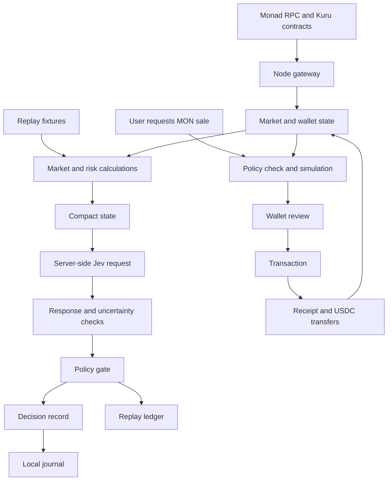

# Architecture

Replay and Live share the market calculations and policy gate. Replay uses synthetic fixtures, heuristic probabilities and a paper ledger. Live reads Kuru, requests Jev assessments when enabled, and prepares a protective MON sale for wallet review. A model decision does not submit a transaction.

## Reads and decisions

The Kuru adapter verifies chain and deployed code, reads parameters at one block, decodes the packed orderbook and reconstructs AMM depth using the SDK's integer arithmetic. It requires positive, uncrossed bids and asks. Contract precision and size bounds govern encoding.

Browser chain reads go through the same-origin /api/rpc endpoint. The server allows only approved read-only RPC methods and uses its configured chain; wallet signing stays with the EIP-1193 provider.

The terminal polls every three seconds locally and every ten seconds on the hosted app; hidden tabs pause polling. The Node gateway caches reads for one second. Mainnet, chain 143, is the default. The documented testnet market on chain 10143 lacked bids during verification. Current measurements are in the [verification report](verification.md).

Wallet reads cover MON and USDC. Historical loss, resting orders, perpetual positions and trade flow are not indexed. The terminal marks missing portfolio fields unavailable. The model receives incomplete live evidence; it cannot authorize unattended trading.

The client compacts state; the server constructs fixed Choice and Noul questions and keeps the API key. Invalid or unavailable inference produces a labeled fallback. Before accepting a decision, the engine checks whether the assessed state has changed. The policy gate independently checks limits, inventory/cash, supplied pending orders, liquidity, slippage and freshness. See [Jev design](jev_design.md) and [risk model](risk_model.md).

Replay fills walk the fixture book and update cash, inventory, basis and PnL. Its short hedge is indicative and omits actual Perpl collateral, fees, funding and liquidation.

## Wallet execution

Live execution supports a native MON market sale for USDC. Preparation reads fresh parameters, checks size/precision, simulates exact calldata and estimates gas. Minimum output covers both quote deterioration and total slippage from the observed midpoint.

The proposal expires after 30 seconds. Before opening the wallet, submission checks account, chain, proposal integrity, current market and simulation. These are application checks: Kuru's direct sell ABI has no deadline, so a wallet prompt can remain open after expiry. Reject a stale prompt.

A returned hash is recorded as submitted. Confirmation verifies the transaction and receipt; token transfers measure delivered USDC. Pending, reverted and confirmed states remain separate, and balances refresh from chain. Read-only simulation has passed; no trade has been signed in this session.

## Journal, contracts and runtime

The gateway serializes JSONL writes under .local/artifacts/audit. SHA-256 links records; startup verifies the active journal and rotation anchor. The UI displays recent records, and export writes into the same directory. Someone controlling both journal and anchor can replace them, so this is a local integrity check rather than an independent attestation.

PolicyGuard is a separate optional custody contract. It compiled with Solidity 0.8.30 and passed local EVM tests; it is not deployed on Monad or used by direct wallet sales. Perpl, Envio indexing and MetaMask Agent Wallet are not integrated.

Development runs Vite on 3000 and Node on 3001. Build/start serves the frontend and API together on loopback port 3000. The public Cloudflare Worker reuses the Kuru/Monad adapters and embeds the built static files. It hard-disables paid inference and keeps audit events in the browser session. See [deployment](deployment.md).
