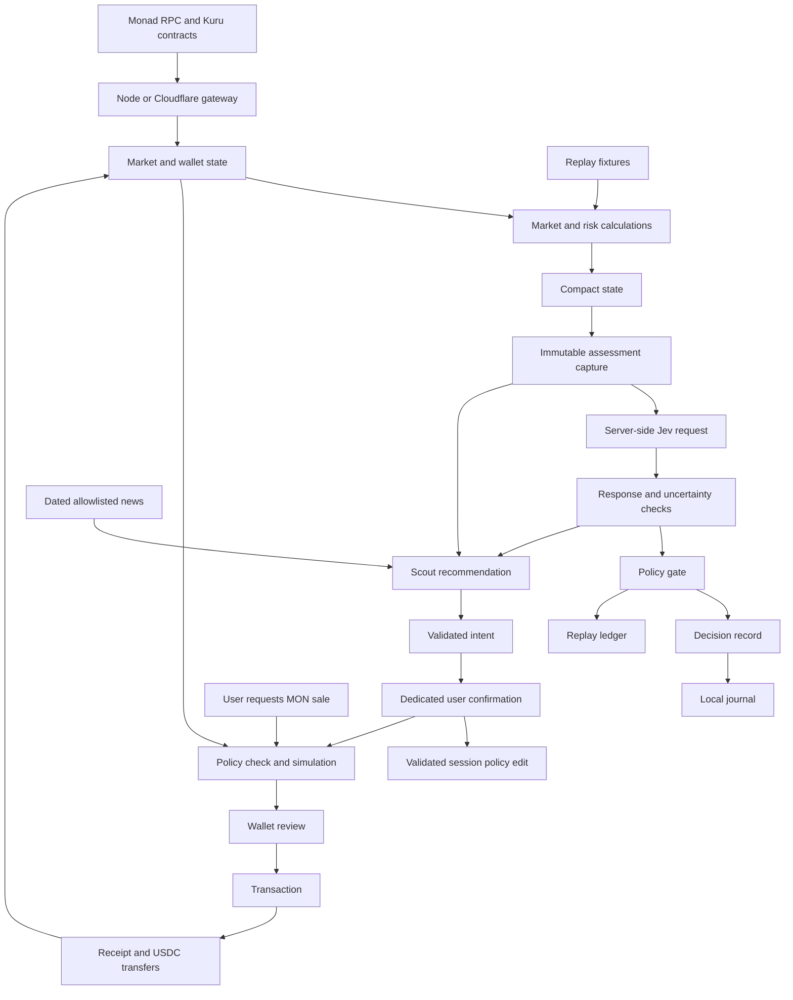

# Architecture

Aegis keeps one React session across the homepage, dashboard and market/execution workspace. Routes change the visible page without resetting conversations, immutable assessments, policies, proposals or submitted hashes. Reloading clears hosted session data and user-entered keys.

Replay and Live share market calculations and the policy gate. Replay uses synthetic fixtures, explicitly heuristic probabilities and a paper ledger. Live reads Kuru and wallet balances, captures evidence for Jev and Scout, and prepares a protective MON sale for wallet review. A model recommendation cannot submit a transaction.

## Reads and decisions

The Kuru adapter verifies chain and deployed code, reads parameters at one block, decodes the packed orderbook and reconstructs AMM depth using the SDK's integer arithmetic. It requires positive, uncrossed bids and asks. Contract precision and size bounds govern encoding.

If Monad briefly cannot retrieve the requested block, the adapter discards that batch and allows one read-only recovery after 200 ms. It captures a new explicit block and repeats all five reads together. Header and packed-book block identity must match. Other failures, invalid data and a second missing-block response still fail closed; this recovery never calls AI or submits a transaction.

Browser chain reads go through the same-origin /api/rpc endpoint. The server allows only approved read-only RPC methods and uses its configured chain; wallet signing stays with the EIP-1193 provider.

Visible workspaces poll every three seconds locally and every ten seconds on the hosted app. Hidden tabs and the homepage pause polling. The Node gateway caches reads for one second. Mainnet, chain 143, is the default. The documented testnet market on chain 10143 lacked bids during verification. Dated measurements are in the [verification report](verification.md).

Wallet reads cover MON and USDC. Historical loss, resting orders, perpetual positions and trade flow are not indexed. The terminal marks missing portfolio fields unavailable. The model receives incomplete live evidence; it cannot authorize unattended trading.

The client compacts state; the server constructs fixed Choice and Noul questions and keeps project credentials. The shared gateway pins `jev-1.13.0`, validates answers and distributions, and preserves their provenance. Invalid or unavailable inference is labelled as unavailable; replay heuristics remain separate. Choice distributions compare the supplied alternatives and do not predict trading success.

An assessment capture includes exact inputs, observation/evaluation timestamps, model identity, original holdings and policy context. It stays separate from refreshed market state and later fills. Signed Jev receipts bind the response to that capture. Evidence uses its captured evaluation time, rather than the time the UI received the reply. Missing original holdings remain unavailable.

Before accepting a decision, the engine checks whether the assessed state has changed. The policy gate independently checks limits, inventory/cash, supplied pending orders, liquidity, slippage and freshness. See [Jev design](jev_design.md) and [risk model](risk_model.md).

Replay fills walk the fixture book and update cash, inventory, basis and PnL. Its short hedge is indicative and omits actual Perpl collateral, fees, funding and liquidation.

## Agent and AI access

Scout receives bounded stateless context containing the same capture, Jev findings when available, user context and dated news. Mistral, OpenAI, Anthropic and Google AI adapters normalize provider responses into an explanation and one typed proposed action. The provider and model remain in the reply's provenance. Recommendations do not inherit Jev probabilities. Disagreement and absent Jev evidence are visible. The chat API has no execution tool, and code rejects unsupported intent fields.

News comes only from fixed CoinDesk and Decrypt RSS feeds with a fifteen-minute cache. Articles retain source links, publication dates and retrieval times; coverage is limited to the preceding 72 hours. News and chat text are untrusted evidence inputs and cannot change permissions or trading safeguards.

The server supports a MON reduction, an allowed session policy edit, an existing replay control or no action. It assigns authorization fields and binds each confirmation token to its immutable intent and arguments, wallet, chain, policy revision and five-minute expiry. Approval is consumed once. Typing yes does not approve or sign. A policy confirmation validates the displayed before/after values and invalidates a prepared trade. Sale confirmation checks fresh context and calls real `/api/prepare`.

Users choose sponsored, user-key or disabled access independently for Jev and Scout. Scout user-key access also selects its vendor; changing the vendor clears the key and any check result. Project credentials and the sponsored provider choice are server configuration. User keys remain in browser memory and private same-origin HTTPS headers; failed user credentials never fall back to sponsorship or another provider. The optional key check performs one fixed read-only model lookup, without a prompt or generation. Model access does not establish generation quota. Hosted trial sessions require a server-validated Turnstile challenge and signed HttpOnly cookie. See [AI access](ai_access.md).

`AiBudgetLedger` is a SQLite Durable Object with a stable namespace and object name. It atomically reserves conservative costs against the US$2 implementation and US$8 public pools, then settles verified usage. Uncertain usage retains its reservation. The same ledger enforces visitor/IP quotas, a single concurrent request, cooldown and consumed approval identifiers. It stores neither keys nor conversations. Local Node uses a persistent file-backed transaction adapter under `.local/artifacts/ai`.

Market polling and automatic replay ticks never start paid inference. Provider calls start only from explicit messages or evaluation requests, with no automatic paid retry or provider fallback. Actual provider verification is recorded separately from adapter tests.

## Wallet execution

Live execution supports a native MON market sale for USDC. Preparation reads fresh parameters, checks size/precision, simulates exact calldata and estimates gas. Minimum output covers both quote deterioration and total slippage from the observed midpoint.

Prepared proposals expire after 30 seconds, with a one-second UI clock. Invalid policy fields block assessment, preparation and signing. Before opening the wallet, submission checks account, chain, policy, proposal integrity, current market and simulation. These are application preflight checks: Kuru's direct sell ABI has no deadline, so a wallet prompt can remain open after expiry. Reject a stale prompt.

A returned hash is recorded as submitted even if receipt retrieval times out. Confirmation verifies transaction calldata/value and successful receipt; token transfers measure delivered USDC. Prepared, awaiting wallet, pending, reverted, stopped and confirmed states remain separate, and balances refresh from chain. Read-only simulation has passed; no trade has been signed in this session.

Manual trades have their own proposal, checks and transaction evidence without AI probability fields. Agent-originated trades also retain the recommendation reference. Assessment evidence stays tied to its original holdings and inputs.

## Journal, contracts and runtime

The gateway serializes JSONL writes under .local/artifacts/audit. SHA-256 links records; startup verifies the active journal and rotation anchor. The UI displays recent records, and export writes into the same directory. Someone controlling both journal and anchor can replace them, so this is a local integrity check rather than an independent attestation.

PolicyGuard is a separate optional custody contract. It compiled with Solidity 0.8.30 and passed local EVM tests; it is not deployed on Monad or used by direct wallet sales. Perpl, Envio indexing and MetaMask Agent Wallet are not integrated.

Development runs Vite on 3000 and Node on 3001. Build/start serves the frontend and API together on loopback port 3000. Cloudflare embeds the built static files and reuses market, simulation and AI handlers, with durable accounting and server secret bindings. Hosted audit events remain in the browser session. The compatibility Worker retains old API/asset requests while redirecting HTML page navigation to the shorter hostname. See [deployment](deployment.md).
